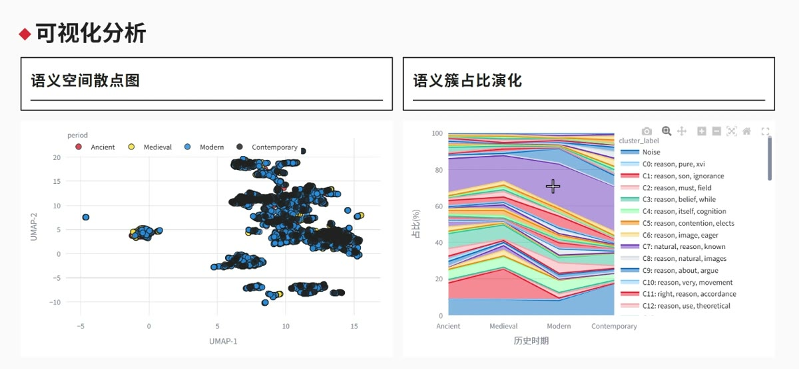

<p align="center">
  
</p>

<h1 align="center">PhilTrace</h1>

<p align="center"><strong>在哲学文本中追踪词义随时代的变化</strong><br>
Diachronic word-sense exploration for philosophy</p>

<p align="center">
  <a href="https://github.com/user-attachments/assets/2d68548a-34dc-4b99-935c-87d6c2e7d9be">▶ 观看演示 · 1:55</a> &nbsp;·&nbsp;
  <a href="#运行样例">分析样例</a> &nbsp;·&nbsp;
  <a href="#快速开始">本地复现</a>
</p>

<p align="center">
  <a href="https://github.com/user-attachments/assets/2d68548a-34dc-4b99-935c-87d6c2e7d9be"></a>
</p>

输入一个英文术语，例如 `reason`，PhilTrace 会从四个时期的哲学文本中提取包含该词的片段，把相近的用法聚成簇，并展示各簇的时期分布。代表语句附有来源，可回到对应的语料文件核对上下文。录屏还展示了选配的哲学对话功能。

## 从原句到语义簇

1. **提取用例。** 从 110 个语料文件中匹配目标词，保留文本片段、来源文件和时期。
2. **编码目标词。** 用 ModernBERT-large 读取句内上下文，通过 tokenizer 的字符偏移定位目标词，再对其子词表示做平均池化。这样，同一个词在不同上下文中会得到不同的向量。
3. **聚类与对照。** 用 UMAP 将向量投影到二维，再用 HDBSCAN 聚类。界面展示语义散点、各时期簇占比和代表语句。
4. **解读语义簇。** 可用 Ollama 或 DeepSeek 根据代表样本生成簇描述和关键词，回到原句检验命名是否贴切。

## 运行样例

用 ModernBERT-large 和 Ollama 的 `qwen3:8b` 分析 `justice`，一次实际运行得到 **2,819 条用例、19 个簇、97 个噪声点**。

| 古代 | 中世纪 | 近代 | 当代 |
| ---: | ---: | ---: | ---: |
| 1,333 | 320 | 860 | 306 |

模型把第 5 簇的 38 条用例解读为「作为道德义务或社会规则的正义」。其中一条来自[亚里士多德《政治学》](corpus/ancient/Aristotle_Politics.txt)：

> Justice, for instance, is a virtue, and so necessary

原句把正义称为一种德性。对照其余用例，可以进一步检查用「社会规则」概括这一簇是否合适。语料混合了经典著作的英文译本和百科条目，切分也保留了部分标题与重复文本。例如，第 0 簇的代表样本重复出现了休谟的同一条章节标题。结果适合用来寻找值得细读的材料。

## 快速开始

准备 Python 3.11 或 3.12。首次分析会从 Hugging Face 下载 ModernBERT 权重，CPU 可以运行。

```bash
git clone https://github.com/cy-7/PhilTrace.git
cd PhilTrace
python -m venv .venv
source .venv/bin/activate
python -m pip install -r requirements.txt -r requirements_backend.txt
```

在两个终端的项目根目录中激活同一个虚拟环境，分别启动后端和前端。

```bash
python -m uvicorn backend.main:app --host 127.0.0.1 --port 8000
```

```bash
python -m streamlit run main.py
```

打开 [Streamlit 界面](http://localhost:8501)，在「概念漂移研究」中输入 `justice` 或 `reason`。[API 文档](http://127.0.0.1:8000/docs)提供 `POST /analyze` 和 `POST /interpret`。基础分析无需 LLM。复现时可在页面末尾的「开发者信息」查看编码模型，后端离线时前端会回退到模拟数据，编码器加载失败时会使用哈希向量兜底。

<details>
<summary>运行 LLM 解读和生成报告</summary>

启动 Ollama 后，下载配置中的默认模型并运行脚本。

```bash
ollama pull qwen3:8b
python -m scripts.run_demo --word justice --provider ollama
```

Markdown 报告写入 `data/demo_output/demo_justice.md`，结构化解读写入 `data/interpretations/justice_interpretations.json`。也可以在网页选择 DeepSeek，填写 API Key，或在启动后端前设置 `DEEPSEEK_API_KEY`。使用 DeepSeek 时，代表语句会传给所选服务生成解读。

</details>

## 代码入口

| 文件 | 用途 |
| --- | --- |
| [backend/analysis_engine.py](backend/analysis_engine.py) | 语料提取、向量缓存、聚类与时期统计 |
| [backend/modernbert_encoder.py](backend/modernbert_encoder.py) | 目标词定位与上下文编码 |
| [backend/sense_interpreter.py](backend/sense_interpreter.py) | 代表样本采集与 LLM 解读 |
| [config/pipeline.yaml](config/pipeline.yaml) | 模型与算法参数 |
| [corpus/](corpus/) | 古代 27、中世纪 10、近代 30、当代 43 个语料文件 |

测试命令为 `python -m unittest discover -s tests -v`。早期实现保存在 [legacy 分支](https://github.com/cy-7/PhilTrace/tree/legacy)。
